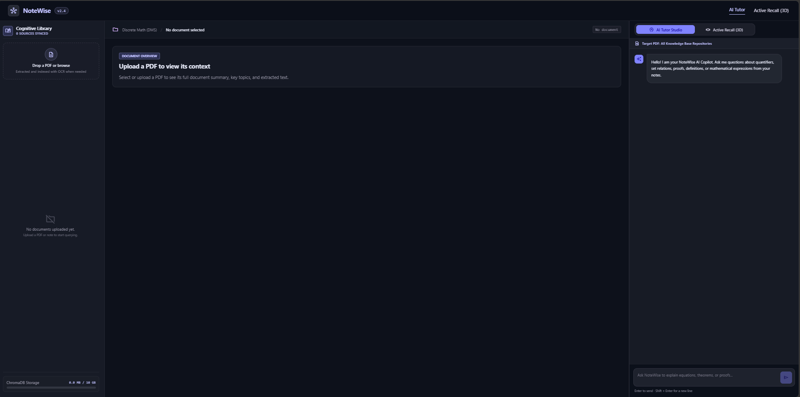
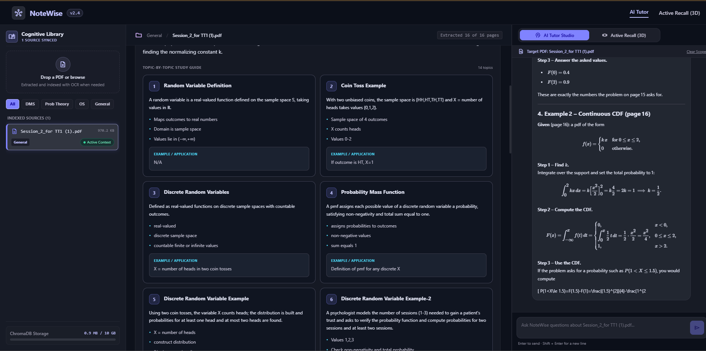
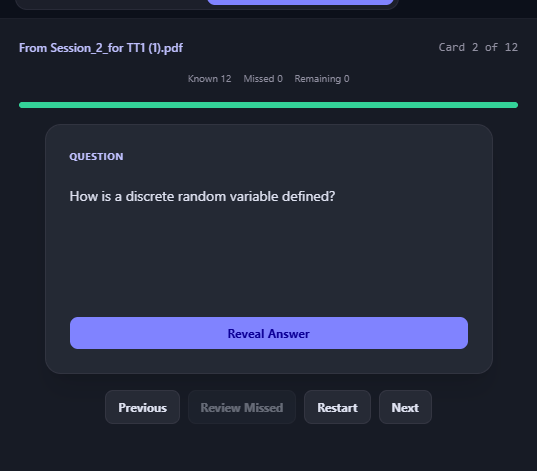
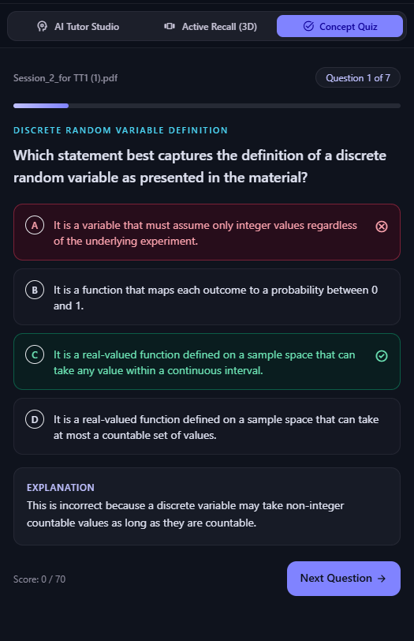
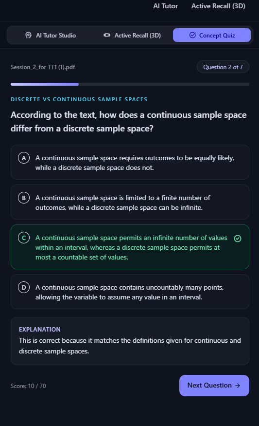
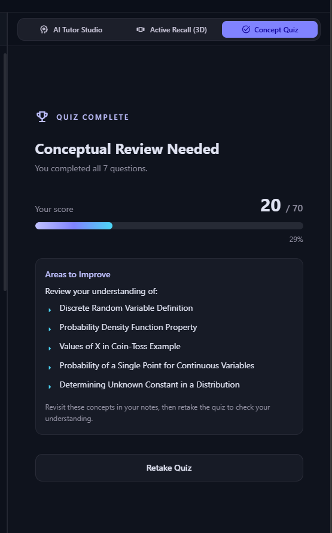
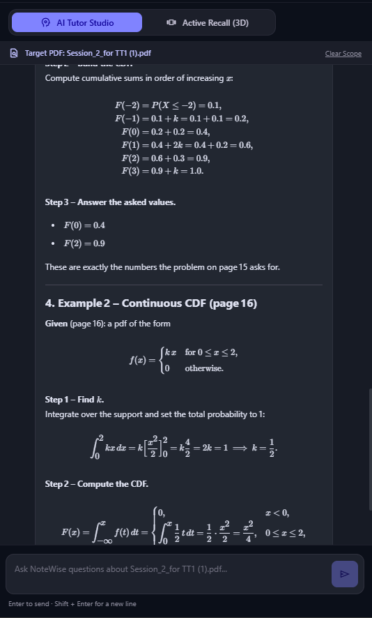
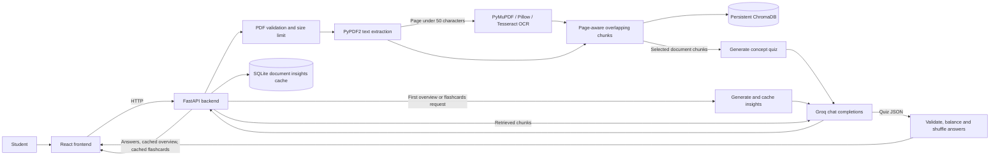

# NoteWise

**Version:** 1.0 test

> A PDF study workspace for organizing course material, searching
> extracted content, and generating source-informed study aids.

NoteWise is a local web application for students. Upload a PDF, inspect
extracted text and page references, retrieve relevant chunks, ask
questions using those chunks as context, and generate an overview or
recall cards. The right panel provides the **AI Tutor Studio**,
**Active Recall (3D)**, and **Concept Quiz** tabs.

The project is actively evolving. See [Current scope and
limitations](#current-scope-and-limitations) for known caveats.

## Features

-   **PDF upload and extraction:** FastAPI accepts PDF uploads up to 20
    MiB and extracts selectable text page by page with
    `PyPDF2.PdfReader`.
-   **OCR fallback:** OCR runs on each page with fewer than 50
    selectable-text characters. PyMuPDF renders those pages, Pillow
    opens the rendered images, and Tesseract via `pytesseract` recognizes
    the text. Tesseract must be installed and configured separately.
-   **Semantic retrieval:** Page text is split into overlapping chunks
    with page metadata and stored in persistent ChromaDB. Queries
    retrieve up to five relevant chunks.
-   **AI question answering:** The backend sends retrieved context to
    the configured Groq chat-completions model. Answers and citations
    are model-generated and are not independently verified.
-   **Document insights:** Generate summaries, topics, concepts, and
    recall flashcards from indexed document content. Overview and
    flashcards are generated when first requested and cached in SQLite.
-   **Workspace focus:** Maximize the AI Tutor, Active Recall, or Concept Quiz panel and restore the previous workspace with the header control or Esc.
-   **Document removal:** Remove an uploaded PDF and its indexed text, overview, flashcards, and quiz source from the app. The original PDF is unchanged.
-   **Concept quiz:** AI selects a question count based on a document's
    indexed chunks. The prompt targets 5–10 questions and backend
    validation accepts 3–10. Each has four options with individual
    explanations; the backend validates the questions and balances
    correct-answer positions. Each question is worth 10 points, with a
    running score and a results screen listing missed topics.
-   **Markdown and math:** The React interface supports Markdown, GitHub
    Flavored Markdown, and LaTeX-style math using `react-markdown`,
    `remark-gfm`, `remark-math`, `rehype-katex`, and KaTeX.

## Screenshots

### NoteWise workspace

The workspace uses a dark, three-panel layout for the Cognitive Library, document context, and AI Tutor.



### Document overview and AI Tutor

After a PDF is uploaded and processed, NoteWise displays a topic-by-topic study guide in the central workspace while the AI Tutor answers questions about the selected document.



### Active Recall Studio

Active Recall turns material from the selected PDF into a question-and-answer review session, with progress tracking and controls to reveal answers, navigate cards, and review missed items.



### Concept Quiz

This question view shows progress at Question 1 of 7, a topic label, four options, and a running score of 0 / 70; the captured view also shows feedback after an answer was selected.



The feedback view marks the selected and correct option, displays the selected option's explanation, and updates the running score to 10 / 70.



The completion view displays a total score of 20 / 70, a percentage, an Areas to Improve topic list, and a Retake Quiz button.



### Mathematical answers

The AI Tutor can present worked probability examples with mathematical notation, equations, and step-by-step explanations.



> **Screenshot note:** The existing workspace screenshots were captured on October 24, 2026, and the Concept Quiz screenshots were captured on November 10, 2026. Quiz questions and answer keys are AI-generated and must be checked against the original material.

Some screenshots predate the maximize control and subject-tag removal. Retake `notewise-empty-state.png`, `notewise-document-overview.png`, `notewise-active-recall.png`, `notewise-quiz-question.png`, `notewise-quiz-feedback.png`, `notewise-quiz-results.png`, and `notewise-math-answers.png`.

## Architecture



### Backend flow

1.  `POST /api/ingest` validates the filename, size, and PDF content.
2.  PyPDF2 extracts text page by page. OCR is attempted on each page
    with fewer than 50 extracted characters; PyMuPDF renders those
    pages, Pillow opens them, and Tesseract recognizes their text.
3.  Page-aware chunks and metadata are stored in ChromaDB and SQLite;
    upload does not generate an overview or flashcards.
4.  The first overview or flashcard GET request generates that content
    from document chunks and caches it in SQLite; later requests return
    the cached content.
5.  `POST /api/query` retrieves matching context and passes selected
    excerpts to the configured Groq model.
6.  `POST /api/generate-quiz` selects the requested document's chunks,
    asks Groq for a quiz, validates and balances/shuffles answer
    positions, then returns questions to the frontend.
7.  Vector records are stored in `backend/chroma_db/`; overview and
    flashcard caches are stored in `backend/document_insights.sqlite3`.

## Technology stack

  -----------------------------------------------------------------------
  Area                                Technology
  ----------------------------------- -----------------------------------
  Backend                             Python, FastAPI, Uvicorn, Pydantic,
                                      `python-multipart`

  PDF and OCR                         PyPDF2, PyMuPDF, Pillow,
                                      `pytesseract`, Tesseract

  Retrieval                           ChromaDB persistent client with
                                      cosine HNSW configuration

  Persistence                         SQLite

  LLM                                 Groq Python SDK (`groq`)

  Frontend                            React 18, React Scripts,
                                      TypeScript, Tailwind CSS,
                                      `react-resizable-panels`, Lucide
                                      React

  Markdown/math                       `react-markdown`, `remark-gfm`,
                                      `remark-math`, `rehype-katex`,
                                      KaTeX
  -----------------------------------------------------------------------

## Repository layout

``` text
.
├── backend/
│   ├── main.py
│   ├── database.py
│   ├── requirements.txt
│   ├── test_*.py
│   └── document_insights.sqlite3  (generated at runtime)
├── frontend/
│   ├── package.json
│   ├── package-lock.json
│   ├── public/
│   └── src/
│       ├── App.tsx
│       ├── index.tsx
│       ├── api.js
│       └── components/
│           ├── InteractiveQuiz.jsx
│           └── *.test.jsx
├── docs/images/
├── .env.example
├── backend/.env.example
├── LICENSE
├── README.md
└── start.ps1
```

Generated ChromaDB and SQLite data directories are created by the
backend and are not source files. The concept quiz component is
`frontend/src/components/InteractiveQuiz.jsx`.

## Setup

### Prerequisites

-   Python 3.10 or newer.
-   Node.js and npm compatible with Create React App / React Scripts.
-   A Groq API key for AI features.
-   For OCR, Tesseract installed separately and configured with
    `TESSERACT_PATH`. PyMuPDF and Pillow are installed from backend
    requirements. Poppler is not used for OCR; its optional path is
    reported by `/api/health` only.
    Selectable-text PDFs may work without OCR if enough text can be
    extracted.

### Install backend dependencies

Run from the repository root in PowerShell:

``` powershell
py -m venv .venv
.\\.venv\\Scripts\\Activate.ps1
python -m pip install -r backend\\requirements.txt
```

### Install frontend dependencies

``` powershell
cd frontend
npm install
cd ..
```

TypeScript, React type definitions, and Markdown/math packages are
listed in `frontend/package.json` and installed by `npm install`.

### Configure environment variables

Copy `backend/.env.example` to `backend/.env` and set values as needed:

``` dotenv
GROQ_API_KEY=your_groq_api_key
GROQ_MODEL=openai/gpt-oss-20b
TESSERACT_PATH=C:/path/to/tesseract.exe
POPPLER_PATH=C:/path/to/poppler/bin
```

-   `GROQ_API_KEY` is required for model-backed features.
-   `GROQ_MODEL` is optional and defaults to `openai/gpt-oss-20b`.
-   `TESSERACT_PATH` points to the OCR executable. `POPPLER_PATH` is
    optional and only affects the Poppler availability diagnostic in
    `/api/health`.
-   The backend loads its environment file relative to
    `backend/main.py`. Never commit real API keys.

### Run locally

Start the backend in one terminal:

``` powershell
cd backend
python -m uvicorn main:app --reload --host 127.0.0.1 --port 8000
```

Start the frontend in another terminal:

``` powershell
cd frontend
npm start
```

The frontend API helper uses `http://127.0.0.1:8000`. When the backend
is running, visit `http://127.0.0.1:8000/api/health` for the health
endpoint and `http://127.0.0.1:8000/docs` for interactive API
documentation.

## API reference

These routes reflect the backend implementation in `backend/main.py`.
They do not implement authentication.

  -----------------------------------------------------------------------------------------------
  Method and path                                 Purpose                 Notes
  ----------------------------------------------- ----------------------- -----------------------
  `GET /`                                         Basic service response  Service identification

  `GET /api/health`                               Report                  Avoid exposing
                                                  service/configuration   operational details
                                                  health                  Includes configured
                                                                          model and tool status

  `POST /api/ingest`                              Upload a PDF using      Rejects invalid/empty
                                                  multipart field `file`; PDFs and uploads over
                                                                          20 MiB

  `DELETE /api/documents/{document_id}`          Remove document and     Deletes indexed chunks and
                                                  cached insights         cached SQLite insights

  `GET /api/documents/{document_id}/overview`     Retrieve or generate a  Returns summary,
                                                  document overview       topics, concepts, and
                                                                          extraction details;
                                                                          generated once and
                                                                          cached in SQLite

  `GET /api/documents/{document_id}/flashcards`   Generate or retrieve    Requires a configured
                                                  recall cards            Requires Groq on a
                                                                          cache miss; result is
                                                                          cached in SQLite

  `POST /api/generate-quiz`                       Generate a concept      JSON body accepts
                                                  quiz                    `document_id` or
                                                                          `document` filename;
                                                                          returns an array of
                                                                          validated questions,
                                                                          each with four options,
                                                                          four explanations,
                                                                          `correctIndex`, and
                                                                          10 points

  `POST /api/query`                               Ask a question using    Accepts `question` or
                                                  retrieved context       `query`, and optional
                                                                          `document_id` or
                                                                          `document` selectors
  -----------------------------------------------------------------------------------------------

### Known frontend/backend route mismatch

`frontend/src/api.js` retains legacy helpers for `/documents` and `/ask`; these routes are not defined in the current backend.

## Retrieval, grounding, and citations

The active query path stores page-aware chunks in ChromaDB and retrieves
up to five results using cosine distance. The assembled context is
clipped to a configured character budget before it is sent to Groq.
Prompts request answers based on the supplied PDF material.

This does not guarantee correctness: extraction can be incomplete,
retrieval can miss relevant passages, and the model can misstate facts
or citations. Verify important answers and page references against the
original PDF.

`backend/database.py` contains a separate SQLite FTS5 implementation.
The current routes in `main.py` do not call it, so FTS5 is not the
active retrieval engine.

## Tests and quality checks

`test_document_insights.py` covers one-call overview generation, valid
page filtering, partial/complete processing status, SQLite caching,
flashcard object/array responses, validation, deduplication, limits, and
insight endpoint errors. `test_quiz.py` covers both accepted quiz option
schemas, rejection of letter references and “all of the above,” and
balanced shuffling with option/explanation pairing. `test_ocr_config.py`
covers OCR executable configuration,
selectable-text PDFs, missing Tesseract, and page-selective OCR.
`test_upload_limits.py` covers oversized PDF rejection.
`test_extraction.py` is a manual PDF text inspection script and defines
no unittest cases. Frontend tests cover Markdown/math configuration and
normalization in `MarkdownAnswer.test.jsx`, plus flashcard loading,
session reset, and review behavior in `RightPanel.test.jsx`.

Run backend tests:

``` powershell
cd backend
python -m unittest discover -p "test_*.py"
```

Run frontend tests:

``` powershell
cd frontend
npm test -- --watchAll=false
```

Recommended manual checks include selectable-text, scanned, and mixed
PDFs; malformed or password-protected PDFs; out-of-source questions;
citation/page accuracy; OCR quality; Groq authentication/model errors;
and inline/display math rendering. Listing a scenario here does not
imply it is fully covered by automated tests.

## Configuration reference

  ------------------------------------------------------------------------
  Variable                Required?               Purpose
  ----------------------- ----------------------- ------------------------
  `GROQ_API_KEY`          For AI operations       Authenticates the Groq
                                                  SDK client

  `GROQ_MODEL`            Optional                Chat model; defaults to
                                                  `openai/gpt-oss-20b`.
                                                  No automatic
                                                  discovery/fallback is
                                                  implemented

  `TESSERACT_PATH`        For OCR                 Full path to the
                                                  Tesseract executable

  `POPPLER_PATH`          Optional                Directory containing
                                                  `pdftoppm`; used only
                                                  for `/api/health`
                                                  availability reporting
  ------------------------------------------------------------------------

## Privacy and security

PDF extraction, chunk storage, and insight persistence run on the
machine hosting the backend. AI-backed questions and generated insights
send document text or retrieved chunks to Groq. Do not upload material
you are not permitted to share with that provider.

The documented routes have no authentication layer. Keep the application
local unless you add suitable authentication, authorization, and network
protections. Local ChromaDB and SQLite files contain extracted study
content and should be treated as user data. Do not commit `.env` files,
API keys, private PDFs, or generated databases.

## Current scope and limitations

-   ChromaDB is the active retrieval path; separate FTS5 code is not
    wired into `main.py`.
-   Some frontend API helpers target legacy routes that do not match the
    current backend.
-   OCR runs page by page when a page has fewer than 50 selectable-text
    characters. It requires Tesseract; PyMuPDF renders the page.
-   Generated summaries, cards, answers, and citations may be incomplete
    or inaccurate.
-   Tutor answers are capped by a max token limit; very long multi-part answers may be cut off and are flagged.
-   Quiz question count varies with the amount of distinct material in a
    document. Quiz questions and answer keys are AI-generated and can be
    wrong; check them against the original material.
-   Serialized Groq calls and retries reduce bursts, but free-tier
    tokens-per-minute limits can still cause temporary HTTP 503 or 429
    errors.
-   Only one configured Groq model is used; automatic discovery/fallback
    is not implemented.
-   No authentication is implemented; this is currently best treated as
    a local development application.
-   Math rendering can display supported LaTeX delimiters, but it cannot
    recover equations or symbols already corrupted during PDF extraction
    or OCR.

## Contributing

Open an issue to discuss a bug or proposed change, then submit a focused
pull request with a clear description and relevant verification steps.
Avoid committing secrets or generated document databases, and update
documentation when behavior or routes change.

## License

This repository includes a `LICENSE` file containing the MIT License.
See [`LICENSE`](LICENSE) for the full terms.
