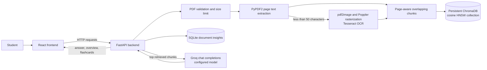

# NoteWise

> A PDF study workspace for organizing course material, searching extracted content, and generating source-informed study aids.

NoteWise is a local web application for students who want to work with lecture notes and study PDFs in one place. Upload a PDF, inspect its extracted text and page references, retrieve relevant chunks, ask questions using those chunks as context, and generate an overview or recall cards. The project is actively evolving; see [Current scope and limitations](#current-scope-and-limitations) for implementation caveats.

## Features

- **PDF upload and extraction:** The FastAPI ingestion route accepts PDF uploads up to 20 MiB and uses `PyPDF2.PdfReader` to extract text page by page. Encrypted PDFs that cannot be opened and zero-page PDFs are rejected.
- **OCR fallback:** When the combined selectable text is under 50 characters, the backend attempts OCR. It rasterizes pages with `pdf2image`/Poppler and recognizes text with Tesseract through `pytesseract`. OCR requires configured executables. Page-level OCR failures are logged and may leave pages without text; ingestion can report an error if OCR cannot run or no usable text is produced.
- **Chunking and semantic retrieval:** Extracted page text is split into overlapping chunks, with page and chunk metadata retained, and stored in a persistent ChromaDB collection. Query retrieval uses the collection's cosine HNSW configuration and returns up to five relevant chunks, bounded by a context character limit.
- **AI question answering:** The backend builds a prompt from retrieved document context and calls the Groq chat completions API. The prompt asks for source-grounded responses and citations, but generated answers and citations are not independently verified.
- **Document insights:** An AI-generated overview includes summary, topics, and concepts. Generated insight data is persisted in a local SQLite database. Flashcards are generated on demand from indexed document chunks; the frontend provides a recall study interface.
- **Study interface:** The React interface is organized into document, context/overview, and tutor/recall panels. Answers are rendered with Markdown, GitHub Flavored Markdown, and KaTeX math support.

## Architecture



### Backend flow

1. `POST /api/ingest` validates the uploaded filename, size, and PDF content.
2. Text is extracted page by page; OCR is attempted when total selectable text is sparse and OCR tools are configured.
3. Text is split into chunks while retaining page and chunk-index metadata, then stored in the `notewise_documents` ChromaDB collection. Ingestion also attempts to generate and save an overview.
4. `POST /api/query` searches ChromaDB for matching context and passes the selected excerpts to the configured Groq model. Source references are based on retrieved metadata and model output.
5. Overview metadata and generated insights use `backend/document_insights.sqlite3`; vector records use `backend/chroma_db/`.

### Main modules

| Path | Responsibility |
| --- | --- |
| `backend/main.py` | FastAPI routes, PDF extraction/OCR, chunk creation, ChromaDB retrieval, Groq prompts, and document insights. |
| `backend/database.py` | A separate SQLite FTS5 page-index/search implementation. It is not the active ingestion/query path in `main.py`. |
| `frontend/src/App.tsx` | Main workspace composition and document/overview UI. |
| `frontend/src/api.js` | Browser API request helpers. Some helpers still target legacy routes absent from the current backend; details below. |
| `frontend/src/components/LeftPanel.js` | Document upload and library panel. |
| `frontend/src/components/RightPanel.js` | Tutor and recall panels. |
| `frontend/src/components/ChatWidget.js` | Chat interaction. |
| `frontend/src/components/MarkdownAnswer.jsx` | Markdown and math answer rendering. |
| `frontend/src/components/ActiveRecallStudio.js` | Flashcard recall interaction. |

## Technology stack

| Area | Verified implementation |
| --- | --- |
| Backend | Python, FastAPI, Uvicorn, Pydantic, `python-multipart` |
| PDF and OCR | PyPDF2, `pdf2image`, Poppler, `pytesseract`, Tesseract |
| Retrieval | ChromaDB persistent client, cosine HNSW collection |
| Insight persistence | Python `sqlite3` and SQLite database |
| LLM | Groq Python SDK (`groq`), configured chat completion model |
| Frontend | React 18, React Scripts, `react-resizable-panels`, Lucide React |
| Answer rendering | `react-markdown`, `remark-gfm`, `remark-math`, `rehype-katex`, KaTeX |

## Repository layout

```text
.
├── backend/
│   ├── main.py
│   ├── database.py
│   ├── requirements.txt
│   └── test_*.py
├── frontend/
│   ├── package.json
│   ├── public/
│   └── src/
│       ├── App.tsx
│       ├── api.js
│       └── components/
├── .env.example
├── backend/.env.example
├── LICENSE
├── README.md
└── start.ps1
```

Generated ChromaDB and SQLite data directories are created by the backend and are not source files.

## Setup

### Prerequisites

- Python 3.10 or newer (the project does not currently pin a Python version).
- Node.js and npm compatible with the React Scripts project.
- A Groq API key for AI features.
- For OCR: Tesseract and Poppler installed separately and their executable locations configured. Native selectable-text PDFs can be processed without OCR when enough text is extracted.

### Install dependencies

From the repository root, create and activate a virtual environment, then install the declared backend requirements:

```powershell
py -m venv .venv
.\.venv\Scripts\Activate.ps1
python -m pip install -r backend\requirements.txt
```

Install frontend packages:

```powershell
cd frontend
npm install
cd ..
```

### Configure environment

The backend loads `backend/.env`. Copy `backend/.env.example` to `backend/.env` and set values as needed:

```dotenv
GROQ_API_KEY=your_groq_api_key
GROQ_MODEL=openai/gpt-oss-120b
TESSERACT_PATH=C:/path/to/tesseract.exe
POPPLER_PATH=C:/path/to/poppler/bin
```

`GROQ_API_KEY` is required for model-backed features. `GROQ_MODEL` is optional and defaults to `openai/gpt-oss-120b`. `TESSERACT_PATH` and `POPPLER_PATH` enable OCR; both must point to valid installed tools for the OCR path to work. The root `.env.example` contains the Groq key placeholder, but the backend specifically loads its environment file relative to `backend/main.py`.

### Run locally

Start the backend from `backend`:

```powershell
cd backend
python -m uvicorn main:app --reload --host 127.0.0.1 --port 8000
```

In a second terminal, start the frontend:

```powershell
cd frontend
npm start
```

The frontend API helper currently hard-codes `http://127.0.0.1:8000`. The backend health endpoint is `GET http://127.0.0.1:8000/api/health`.

## API reference

The backend routes below do not implement authentication. Request models and response details are summarized from `backend/main.py`.

| Method and path | Purpose and request | Response / constraints |
| --- | --- | --- |
| `GET /` | Basic service response. | Service identification. |
| `GET /api/health` | Report service/configuration health. | Includes configured model and whether a Groq key/client is available; do not publish health output if it contains operational details. |
| `POST /api/ingest` | Multipart form with PDF `file` and optional subject field. | Document identity, page/extraction information, and overview result/error. Rejects non-PDF names, empty files, uploads over 20 MiB, invalid/protected PDFs, or unsuccessful extraction. |
| `GET /api/documents/{document_id}/overview` | Retrieve or generate the document overview. | Summary, topics, concepts, extraction status and excerpt when available. Unknown document IDs return an error. |
| `GET /api/documents/{document_id}/flashcards` | Generate or retrieve recall cards for a document. | Card data generated from stored chunks; requires a configured Groq client. |
| `POST /api/query` | JSON body accepts optional `question` or `query`, and optional `document_id` or `document` selectors. | Model answer and source/context metadata. Requires a Groq key; model/provider errors are surfaced by the handler. |

FastAPI's interactive schema is available at `/docs` when the backend is running.

### Frontend/backend route mismatch

`frontend/src/api.js` also calls `/documents`, `/documents/{docName}`, and `/ask`. Those routes are not defined in the current `backend/main.py`. Consequently, document listing/deletion or the legacy ask helpers may fail against this backend until the integration is reconciled. The current documented routes above reflect the backend implementation, not assumptions based on frontend helper names.

## Retrieval, grounding, and citations

The active path in `main.py` stores page-aware chunks in ChromaDB and retrieves up to five results using the configured cosine distance space. The backend clips the assembled context to its configured character budget before sending it to Groq. Prompts request answers based on supplied PDF material and use source information for attribution. This reduces unsupported answers but does not guarantee correctness: extraction may be incomplete, retrieval may miss relevant material, and the LLM may misstate facts or citations. Citation links and exact page display should be checked against the source PDF.

`backend/database.py` contains a distinct SQLite FTS5 implementation with page search and snippets. The current `main.py` routes do not call that module, so FTS5 should not be described as the active retrieval engine.

## Tests and quality checks

The repository contains backend tests for extraction, OCR configuration, document insights, and upload limits, plus frontend tests for Markdown answers and the right panel. Test commands are:

```powershell
cd backend
python -m unittest discover -p "test_*.py"
```

```powershell
cd frontend
npm test -- --watchAll=false
```

Useful manual checks include selectable-text PDFs, scanned and mixed PDFs, empty or malformed PDFs, out-of-source questions, citation/page matching, OCR quality, and Groq authentication/model failures. These are recommended scenarios; their presence in this list does not mean each is covered by automated tests.

## Configuration reference

| Variable | Required? | Purpose |
| --- | --- | --- |
| `GROQ_API_KEY` | Required for AI operations | Authenticates the Groq SDK client. |
| `GROQ_MODEL` | Optional | Selects the chat completion model; default is `openai/gpt-oss-120b`. There is no dynamic discovery or automatic model fallback in the current code. |
| `TESSERACT_PATH` | Optional for native-text PDFs; required for OCR | Full path to the Tesseract executable. |
| `POPPLER_PATH` | Optional for native-text PDFs; needed for OCR rendering when not otherwise available | Directory containing `pdftoppm` (`pdftoppm.exe` on Windows). |

## Privacy and security

PDF extraction, chunk storage, and insight persistence run on the machine hosting the backend. AI-backed questions and generated insights send document text or retrieved chunks to the Groq API. Do not upload material you are not permitted to share with that provider. The application has no authentication layer in the documented routes; deploy only in an environment appropriate to that exposure and configure network access accordingly. Local ChromaDB and SQLite files contain extracted study content and should be treated as user data.

## Current scope and limitations

- ChromaDB retrieval is the active query path; the separate FTS5 code is not wired into `main.py`.
- The frontend has legacy API calls that do not match current backend routes.
- OCR depends on separately installed Tesseract and Poppler binaries. OCR is only attempted when extracted selectable text is very sparse.
- Generated summaries, cards, answers, and citations are model outputs and may be incomplete or inaccurate.
- The backend uses one configured Groq model; automatic model discovery/fallback is not implemented.
- No authentication is implemented. The project is best treated as a local development application in its current form.

## Contributing

Open an issue to discuss a bug or proposed change, then submit a focused pull request with a clear description and relevant verification steps. Keep changes scoped, avoid committing secrets or generated document databases, and update documentation when behavior or routes change.

## License

The repository includes a `LICENSE` file containing the MIT License. See [LICENSE](LICENSE) for the full terms.
