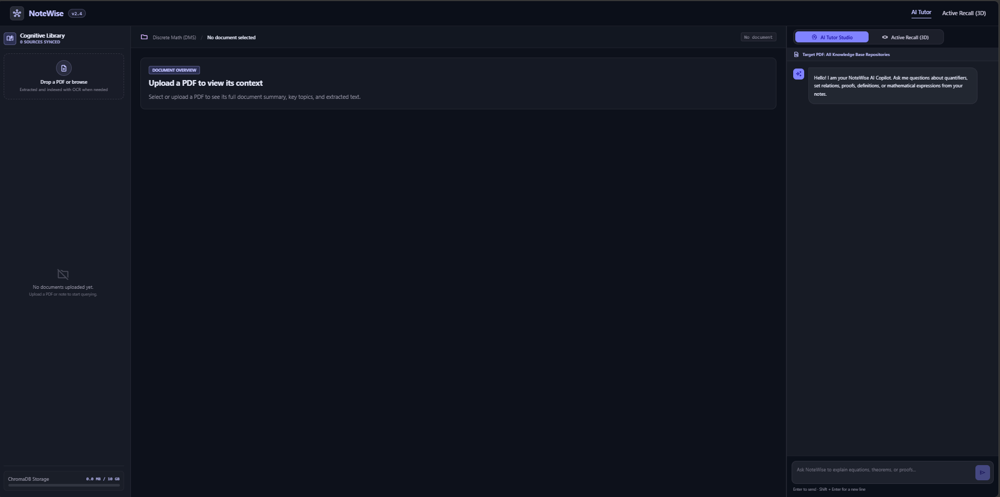
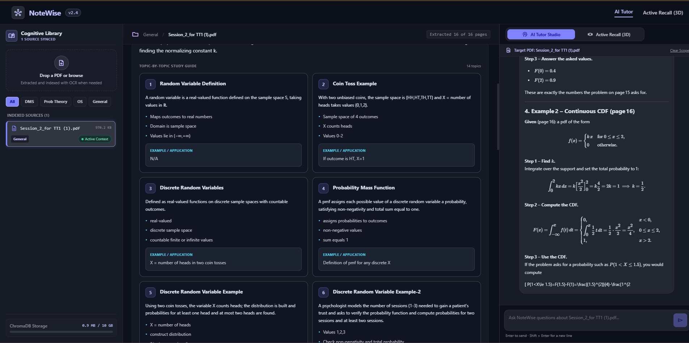
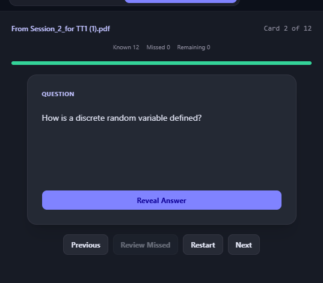
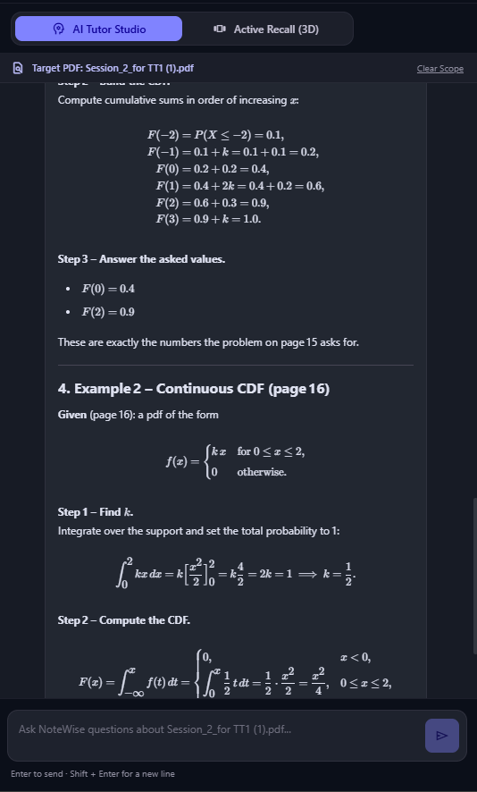
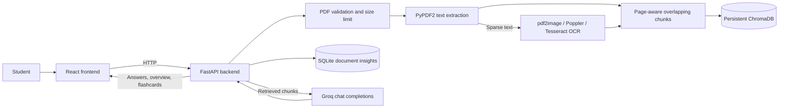

# NoteWise

> A PDF study workspace for organizing course material, searching
> extracted content, and generating source-informed study aids.

NoteWise is a local web application for students. Upload a PDF, inspect
extracted text and page references, retrieve relevant chunks, ask
questions using those chunks as context, and generate an overview or
recall cards.

The project is actively evolving. See [Current scope and
limitations](#current-scope-and-limitations) for known caveats.

## Features

-   **PDF upload and extraction:** FastAPI accepts PDF uploads up to 20
    MiB and extracts selectable text page by page with
    `PyPDF2.PdfReader`.
-   **OCR fallback:** When combined selectable text is under 50
    characters, the backend can rasterize pages with `pdf2image`/Poppler
    and recognize text using Tesseract via `pytesseract`. These tools
    must be installed and configured separately.
-   **Semantic retrieval:** Page text is split into overlapping chunks
    with page metadata and stored in persistent ChromaDB. Queries
    retrieve up to five relevant chunks.
-   **AI question answering:** The backend sends retrieved context to
    the configured Groq chat-completions model. Answers and citations
    are model-generated and are not independently verified.
-   **Document insights:** Generate summaries, topics, concepts, and
    recall flashcards from indexed document content. Overview data is
    persisted in SQLite.
-   **Markdown and math:** The React interface supports Markdown, GitHub
    Flavored Markdown, and LaTeX-style math using `react-markdown`,
    `remark-gfm`, `remark-math`, `rehype-katex`, and KaTeX.

## Screenshots

### NoteWise workspace

The workspace uses a dark, three-panel layout for the Cognitive Library, document context, and AI Tutor.



### Document overview and AI Tutor

After a PDF is uploaded and processed, NoteWise displays a topic-by-topic study guide in the central workspace while the AI Tutor answers questions about the selected document.



### Active Recall Studio

Active Recall turns material from the selected PDF into a question-and-answer review session, with progress tracking and controls to reveal answers, navigate cards, and review missed items.



### Mathematical answers

The AI Tutor can present worked probability examples with mathematical notation, equations, and step-by-step explanations.



> **Screenshot note:** These images show the interface and examples as captured on October 24, 2026. AI-generated content should still be checked against the original course material.

## Architecture



### Backend flow

1.  `POST /api/ingest` validates the filename, size, and PDF content.
2.  Text is extracted page by page; OCR is attempted when selectable
    text is sparse and OCR tools are configured.
3.  Page-aware chunks are stored in the `notewise_documents` ChromaDB
    collection. Ingestion also attempts to generate and save an
    overview.
4.  `POST /api/query` retrieves matching context and passes selected
    excerpts to the configured Groq model.
5.  Overview data is stored in `backend/document_insights.sqlite3`;
    vector records are stored in `backend/chroma_db/`.

## Technology stack

  -----------------------------------------------------------------------
  Area                                Technology
  ----------------------------------- -----------------------------------
  Backend                             Python, FastAPI, Uvicorn, Pydantic,
                                      `python-multipart`

  PDF and OCR                         PyPDF2, `pdf2image`, Poppler,
                                      `pytesseract`, Tesseract

  Retrieval                           ChromaDB persistent client with
                                      cosine HNSW configuration

  Persistence                         SQLite

  LLM                                 Groq Python SDK (`groq`)

  Frontend                            React 18, React Scripts,
                                      TypeScript,
                                      `react-resizable-panels`, Lucide
                                      React

  Markdown/math                       `react-markdown`, `remark-gfm`,
                                      `remark-math`, `rehype-katex`,
                                      KaTeX
  -----------------------------------------------------------------------

## Repository layout

``` text
.
├── backend/
│   ├── main.py
│   ├── database.py
│   ├── requirements.txt
│   └── test_*.py
├── frontend/
│   ├── package.json
│   ├── public/
│   └── src/
│       ├── App.tsx
│       ├── index.tsx
│       ├── api.js
│       └── components/
├── .env.example
├── backend/.env.example
├── LICENSE
├── README.md
└── start.ps1
```

Generated ChromaDB and SQLite data directories are created by the
backend and are not source files. Component filenames may change as the
frontend evolves.

## Setup

### Prerequisites

-   Python 3.10 or newer.
-   Node.js and npm compatible with Create React App / React Scripts.
-   A Groq API key for AI features.
-   For OCR, Tesseract and Poppler installed separately and configured.
    Selectable-text PDFs may work without OCR if enough text can be
    extracted.

### Install backend dependencies

Run from the repository root in PowerShell:

``` powershell
py -m venv .venv
.\\.venv\\Scripts\\Activate.ps1
python -m pip install -r backend\\requirements.txt
```

### Install frontend dependencies

``` powershell
cd frontend
npm install
cd ..
```

If TypeScript or math-rendering packages are missing, run these from
`frontend`:

``` powershell
npm install --save-dev typescript@4.9.5 @types/react@18 @types/react-dom@18 @types/node
npm install react-markdown remark-math remark-gfm rehype-katex katex
```

### Configure environment variables

Copy `backend/.env.example` to `backend/.env` and set values as needed:

``` dotenv
GROQ_API_KEY=your_groq_api_key
GROQ_MODEL=openai/gpt-oss-120b
TESSERACT_PATH=C:/path/to/tesseract.exe
POPPLER_PATH=C:/path/to/poppler/bin
```

-   `GROQ_API_KEY` is required for model-backed features.
-   `GROQ_MODEL` is optional and defaults to `openai/gpt-oss-120b`.
-   `TESSERACT_PATH` and `POPPLER_PATH` point to OCR tools.
-   The backend loads its environment file relative to
    `backend/main.py`. Never commit real API keys.

### Run locally

Start the backend in one terminal:

``` powershell
cd backend
python -m uvicorn main:app --reload --host 127.0.0.1 --port 8000
```

Start the frontend in another terminal:

``` powershell
cd frontend
npm start
```

The frontend API helper uses `http://127.0.0.1:8000`. When the backend
is running, visit `http://127.0.0.1:8000/api/health` for the health
endpoint and `http://127.0.0.1:8000/docs` for interactive API
documentation.

## API reference

These routes reflect the backend implementation in `backend/main.py`.
They do not implement authentication.

  -----------------------------------------------------------------------------------------------
  Method and path                                 Purpose                 Notes
  ----------------------------------------------- ----------------------- -----------------------
  `GET /`                                         Basic service response  Service identification

  `GET /api/health`                               Report                  Avoid exposing
                                                  service/configuration   operational details
                                                  health                  publicly

  `POST /api/ingest`                              Upload a PDF using      Rejects invalid/empty
                                                  multipart field `file`; PDFs and uploads over
                                                  optional subject field  20 MiB

  `GET /api/documents/{document_id}/overview`     Retrieve or generate a  Returns summary,
                                                  document overview       topics, concepts, and
                                                                          extraction details when
                                                                          available

  `GET /api/documents/{document_id}/flashcards`   Generate or retrieve    Requires a configured
                                                  recall cards            Groq client

  `POST /api/query`                               Ask a question using    Accepts `question` or
                                                  retrieved context       `query`, and optional
                                                                          document selectors
  -----------------------------------------------------------------------------------------------

### Known frontend/backend route mismatch

`frontend/src/api.js` also calls `/documents`, `/documents/{docName}`,
and `/ask`. These routes are not defined in the current
`backend/main.py`, so document listing/deletion or legacy ask helpers
may fail until the integration is reconciled.

## Retrieval, grounding, and citations

The active query path stores page-aware chunks in ChromaDB and retrieves
up to five results using cosine distance. The assembled context is
clipped to a configured character budget before it is sent to Groq.
Prompts request answers based on the supplied PDF material.

This does not guarantee correctness: extraction can be incomplete,
retrieval can miss relevant passages, and the model can misstate facts
or citations. Verify important answers and page references against the
original PDF.

`backend/database.py` contains a separate SQLite FTS5 implementation.
The current routes in `main.py` do not call it, so FTS5 is not the
active retrieval engine.

## Tests and quality checks

Backend tests cover areas such as extraction, OCR configuration,
document insights, and upload limits. Frontend tests cover Markdown
answers and the right panel.

Run backend tests:

``` powershell
cd backend
python -m unittest discover -p "test_*.py"
```

Run frontend tests:

``` powershell
cd frontend
npm test -- --watchAll=false
```

Recommended manual checks include selectable-text, scanned, and mixed
PDFs; malformed or password-protected PDFs; out-of-source questions;
citation/page accuracy; OCR quality; Groq authentication/model errors;
and inline/display math rendering. Listing a scenario here does not
imply it is fully covered by automated tests.

## Configuration reference

  ------------------------------------------------------------------------
  Variable                Required?               Purpose
  ----------------------- ----------------------- ------------------------
  `GROQ_API_KEY`          For AI operations       Authenticates the Groq
                                                  SDK client

  `GROQ_MODEL`            Optional                Chat model; defaults to
                                                  `openai/gpt-oss-120b`.
                                                  No automatic
                                                  discovery/fallback is
                                                  implemented

  `TESSERACT_PATH`        For OCR                 Full path to the
                                                  Tesseract executable

  `POPPLER_PATH`          For OCR when not        Directory containing
                          otherwise available     `pdftoppm`
                                                  (`pdftoppm.exe` on
                                                  Windows)
  ------------------------------------------------------------------------

## Privacy and security

PDF extraction, chunk storage, and insight persistence run on the
machine hosting the backend. AI-backed questions and generated insights
send document text or retrieved chunks to Groq. Do not upload material
you are not permitted to share with that provider.

The documented routes have no authentication layer. Keep the application
local unless you add suitable authentication, authorization, and network
protections. Local ChromaDB and SQLite files contain extracted study
content and should be treated as user data. Do not commit `.env` files,
API keys, private PDFs, or generated databases.

## Current scope and limitations

-   ChromaDB is the active retrieval path; separate FTS5 code is not
    wired into `main.py`.
-   Some frontend API helpers target legacy routes that do not match the
    current backend.
-   OCR depends on separately installed Tesseract and Poppler. It is
    attempted only when extracted selectable text is sparse.
-   Generated summaries, cards, answers, and citations may be incomplete
    or inaccurate.
-   Only one configured Groq model is used; automatic discovery/fallback
    is not implemented.
-   No authentication is implemented; this is currently best treated as
    a local development application.
-   Math rendering can display supported LaTeX delimiters, but it cannot
    recover equations or symbols already corrupted during PDF extraction
    or OCR.

## Contributing

Open an issue to discuss a bug or proposed change, then submit a focused
pull request with a clear description and relevant verification steps.
Avoid committing secrets or generated document databases, and update
documentation when behavior or routes change.

## License

This repository includes a `LICENSE` file containing the MIT License.
See [`LICENSE`](LICENSE) for the full terms.
